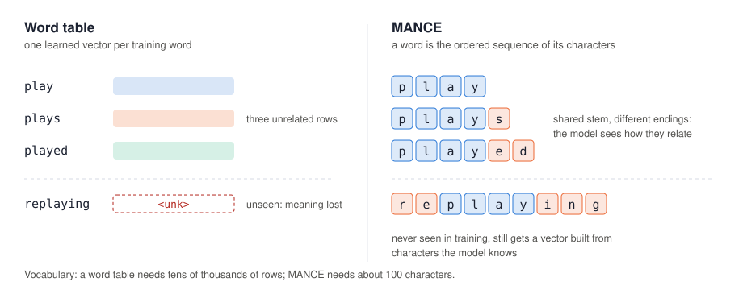
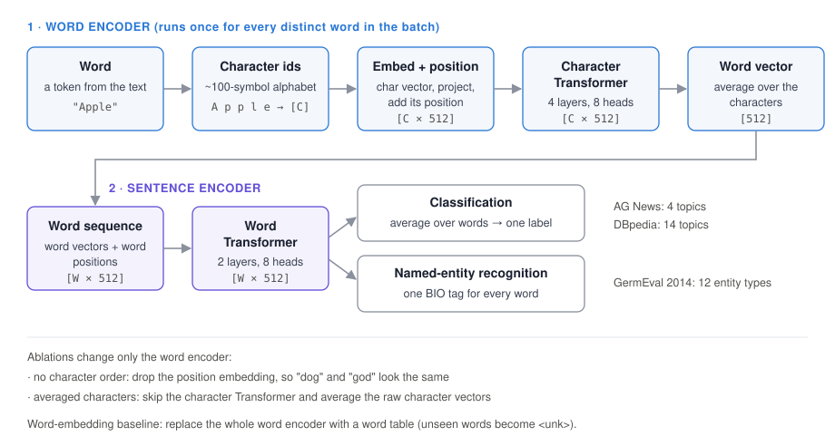
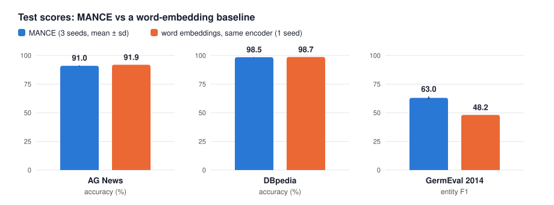
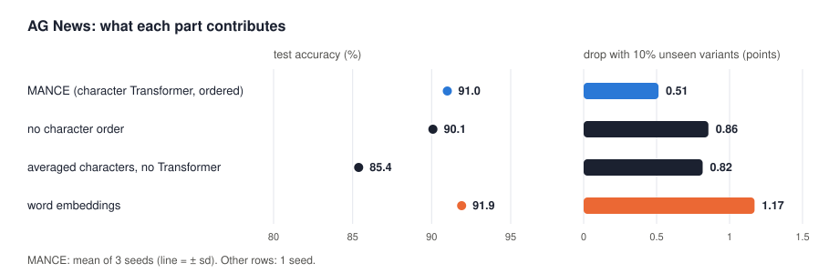
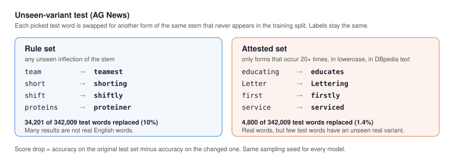

# MANCE: Morphology-Aware Nested Character Embeddings

Word vectors built from characters instead of looked up in a word table. Every word, including one never seen in training, is encoded from the ordered sequence of its characters, so related forms such as *play*, *plays* and *replaying* share most of their computation.

This repository holds a PyTorch implementation, a single script that trains and evaluates it on English topic classification (AG News, DBpedia) and German named-entity recognition (GermEval 2014), a test with unseen word forms, two ablations, and the run files behind every number below.

## The idea



A word-embedding model learns one vector per training word. *play*, *plays* and *played* get three unrelated vectors, and a word missing from the table becomes `<unk>`. MANCE needs only an alphabet of about 100 characters. It reads a word's characters in order and turns them into a word vector, so a new inflection of a known stem still gets a sensible representation.

## Model



1. **Characters.** Each word is split into character ids (printable ASCII plus German letters, 104 ids with padding and unknown).
2. **Character Transformer.** Character embeddings (dimension 100) are projected to 512, given position embeddings and passed through a 4-layer, 8-head Transformer. Averaging its outputs gives one 512-dimensional vector per word.
3. **Word Transformer.** The word vectors, with word positions, go through a 2-layer Transformer.
4. **Output.** Classification averages over the words and predicts one label; NER predicts a BIO tag for every word.

Every distinct word in a batch is encoded once and reused wherever it occurs, which keeps the character Transformer affordable.

The **word-embedding baseline** replaces steps 1–2 with a word table (training words seen at least twice, up to 50,000) and keeps everything else identical.

## Results

All numbers are test-set results from `experiments/runs/*.json`. MANCE was trained with 3 seeds (mean ± sd); the baseline and the ablations with 1 seed.



| Dataset | Metric | MANCE | Word embeddings |
|---|---|---|---|
| AG News (4 topics) | accuracy | 90.99 ± 0.34 | 91.89 |
| DBpedia (14 topics) | accuracy | 98.48 ± 0.11 | 98.69 |
| GermEval 2014 (German NER) | entity F1 | **63.02 ± 1.15** | 48.16 |

- **German NER:** MANCE is 14.9 F1 ahead. German has many inflected forms, compounds and rare names, which a word table cannot cover but characters can.
- **English topic classification:** the two are on par; the word table is slightly ahead. Topic labels in news and Wikipedia text are carried by frequent words, so building words from characters brings little here.

### What each part contributes (AG News)



| Word encoder | Accuracy | Drop with unseen variants (rule set) |
|---|---|---|
| Character Transformer, ordered (MANCE) | 90.99 ± 0.34 | 0.51 ± 0.14 |
| No character order (positions removed) | 90.08 | 0.86 |
| Averaged characters (no Transformer) | 85.38 | 0.82 |
| Word embeddings | 91.89 | 1.17 |

- Encoding the characters matters: averaging them instead costs 5.6 points.
- Their order matters too: without position embeddings, *dog* and *god* get the same vector, and accuracy falls by 0.9 points.
- With 10% of test words replaced by unseen variants, MANCE loses 0.5 points and the word table 1.2.

### Unseen-variant test



Test words are replaced by other forms of the same stem that never occur in the training split. Two versions are built with a fixed seed, so every model sees the same changed text:

- **Rule set:** 10% of test words, any unseen inflection. Many replacements are not real English words.
- **Attested set:** only forms that appear at least 20 times in lowercase in DBpedia text. These are real words, but only 1.4% of AG News test words have one, and no model loses more than 0.11 points on it.

## Reproduce

```bash
pip install -r requirements-experiments.txt
python run.py train configs/ag_news.yaml --seed 1
python run.py train configs/ag_news.yaml --seed 1 --tag word_baseline --set model.embedding=word
python run.py table                 # rebuilds experiments/RESULTS.md
python scripts/plot_results.py      # rebuilds the result figures
```

`scripts/run_all.sh` runs all 14 experiments, several at a time on one GPU (`JOBS=4`). On one RTX 4090 that took about 5 hours; an AG News epoch takes 84 s when the GPU is not shared. Datasets download from Hugging Face on first use, and each run writes its config, per-epoch history, test scores, parameter count, dataset revision and software versions to `experiments/runs/`.

### Training details

| Setting | Value |
|---|---|
| Optimiser | Adam, batch 64, linear warm-up over 1,000 steps, gradient clipping at 1.0 |
| Learning rate | 1e-4 (AG News, DBpedia), 3e-4 (GermEval), chosen on validation; see `experiments/sweeps/` |
| Dropout | 0.3 |
| Epochs | up to 20; the checkpoint with the best validation score is kept (patience 3) |
| Validation | 5% of train for AG News and DBpedia (split with the run seed); the official dev set for GermEval |
| Test | used once per run, after training |
| Truncation | 64 words per text, 16 characters per word |

## Limitations

- The baseline and the ablations have one seed each. MANCE's seed-to-seed spread on AG News is 0.34 points, so differences below about 1 point there are not conclusive.
- GermEval uses a plain softmax tagger trained from scratch, without a CRF or pretrained embeddings, and two of three seeds reached the 20-epoch cap with their best epoch at 18 or 19. The absolute F1 is therefore low; the comparison with the baseline uses the same setup on both sides.
- AG News seeds 2 and 3 stopped early (epoch 10) because validation accuracy moves by about a point between epochs; a decaying learning rate would likely help.
- Some attested replacements are related only in spelling (*according* → *accordion*).

## Repository layout

```
run.py                  train / evaluate / build the results table
mance/                  data loading, model, unseen-variant test
configs/                one config per dataset
scripts/run_all.sh      every experiment in the results
scripts/plot_results.py result figures from the run files
experiments/            RESULTS.md, run files, logs, learning-rate sweeps
docs/figures/           the figures in this README
mance_method.py, compare_methods.py, baseline_word2vec.py
                        the original small BiLSTM demo (40 sentences)
```

## Citation

G. S. S. K. Kurra, C. Moparthi, P. M. Chowdary and P. K. Pagadala, "Morphology-Aware Nested Character Embeddings for Word Representation," IEEE ICCCMLA 2025. IEEE Xplore document [11580466](https://ieeexplore.ieee.org/document/11580466).
